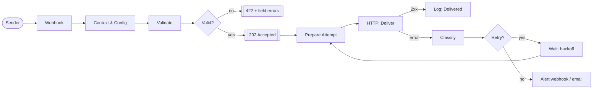

# n8n-production-ready-demo

An importable n8n workflow that shows what "production-ready" means for a simple webhook integration: **validation, retries with exponential backoff, an error branch, structured logging, and a failure alert**, plus a runbook.

> **Public sample.** Not a client project. It uses a mock downstream API and made-up payloads. Nothing here comes from any employer or client system.


## What is inside

| Path | What it is |
| --- | --- |
| `workflows/order-intake.json` | The main workflow (17 nodes), in n8n's workflow export format |
| `workflows/global-error-handler.json` | Error Trigger workflow for unexpected crashes |
| `docs/architecture.md` | Mermaid diagrams, design decisions, log format |
| `docs/runbook.md` | Operating guide: config, alerts, replaying a failed order, known limits |
| `fixtures/` | Sample payloads for each path (valid, invalid, transient, rate-limited, permanent, down) |
| `mock/mock_api.py` | Stdlib-only mock downstream API and alert sink |
| `tools/build_workflow.py` | Generates the workflow JSON; Code-node JavaScript is reviewed here as code |
| `tools/validate_workflow.py` | Static checks: structure, connections, no embedded credentials or secrets |
| `tools/send_fixtures.sh` | Sends every fixture to the webhook |
| `docker-compose.yml` | n8n 2.47.7 and the mock API |

## The workflow



- **Validation:** required fields, types, ISO currency, email shape, line items. Bad input gets `422` with a field list and never reaches the downstream.
- **Retries:** only `408/425/429/5xx` and network errors. Waits of about 1 s, 2 s, 4 s with jitter, capped, up to 4 attempts. Other `4xx` errors fail fast.
- **Idempotency:** every attempt sends `Idempotency-Key: <event_id>`, so retries and replays do not create duplicates downstream.
- **Error branch:** the HTTP node's error output feeds a classify step, so failures become data, not a crashed execution.
- **Structured logs:** one JSON line per step with `correlation_id`, `step`, `outcome`, `attempt` and `status_code`. Also stored on each item for the execution view.
- **Alerts:** a generic JSON webhook (Slack, Teams or anything else) carrying references only, plus an optional email node. A separate Error Trigger workflow covers crashes.

## Quick start

```bash
docker compose up -d
docker compose exec n8n n8n import:workflow --input=/workflows/order-intake.json
docker compose exec n8n n8n import:workflow --input=/workflows/global-error-handler.json
```

Open http://localhost:5678, create the local owner account, open **Order Intake - production-ready demo**, and publish (activate) it. Or import the JSON files through **Workflows → Import from file**. Then:

```bash
tools/send_fixtures.sh
curl -s http://localhost:8081/alerts      # alerts for the permanent and "down" cases
docker compose logs n8n | grep order-intake
```

Expected:

```
downstream-down-order        202  {"status":"accepted",...}   -> 4 attempts, then alert
invalid-order                422  {"status":"invalid",...,"errors":[...]}
permanent-failure-order      202  {"status":"accepted",...}   -> 1 attempt (422), alert
rate-limited-order           202  {"status":"accepted",...}   -> 429, delivered on attempt 2
transient-failure-order      202  {"status":"accepted",...}   -> 503, 503, delivered on attempt 3
valid-order                  202  {"status":"accepted",...}   -> delivered on attempt 1
```

## How it was checked

- `tools/validate_workflow.py` passes on both files. CI runs it, confirms the generated JSON is up to date, and imports both workflows into a throwaway n8n with the CLI.
- Both workflows were imported into n8n 2.47.7 and Order Intake was published. Every fixture was sent to the live webhook against the mock API. All six paths behaved as in the table above, including backoff waits of about 1 s, 1.6 s and 2.6 s, and alerts with the right attempt counts and status codes.

## Using this pattern on a real integration

Change `CONFIG` in **Set Context & Config**, move any tokenised URLs into n8n credentials, adapt the mapping in **Validate Payload**, set the error workflow, and follow `docs/runbook.md`. The same contract is implemented in Python, with tests, in the companion repository `python-webhook-reliability-demo`.

## Licence

MIT
