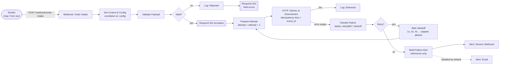
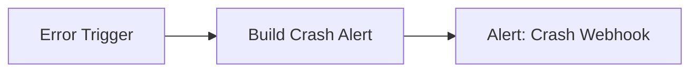

# Architecture

> Public sample with a mock downstream API. Not a client system.

## Flow



A second workflow, **Global Error Handler**, uses n8n's Error Trigger. It catches anything the main workflow's own error branch did not, for example a bug in a Code node, and sends a short crash alert.



## Design decisions

| Decision | Why |
| --- | --- |
| Respond `202` right after validation | The sender gets a fast answer and does not time out or resend while the delivery is retried. Bad input still gets a synchronous `422`, so the sender can fix it. |
| Explicit retry loop, not the node's built-in retry | The built-in "Retry On Fail" waits a fixed interval and retries everything. The loop retries only `408/425/429/5xx` and network errors, uses exponential backoff with jitter, and logs every attempt. |
| Same `Idempotency-Key` on every attempt | A downstream API that supports idempotency keys will not create duplicates if an attempt timed out after it succeeded on their side. |
| Error output on the HTTP node (`continueErrorOutput`) | Failures are data that flow into the classify step, instead of stopping the execution. |
| State re-read from `Prepare Attempt` | The HTTP node's error output carries only the error. The classify step reads the order and attempt count from the paired item of `Prepare Attempt`. |
| Alerts carry references, not payloads | Order id, event id, correlation id, attempts and status code are enough to find the execution. No customer email or body is sent to a chat channel. |
| Alert node continues on its own failure | A broken alert channel must not hide the original failure. The execution is still saved with every log entry. |
| Config in one Code node, no secrets | Everything you change after import is in one place. URLs that include tokens belong in n8n credentials or environment variables, not in the workflow JSON. |

## Structured log format

Every Code node writes one JSON line per item and appends the same entry to `item.logs`:

```json
{"ts":"2026-11-15T21:05:10.663Z","level":"warn","workflow":"order-intake","execution_id":"6",
 "correlation_id":"demo-downstream-down-order","step":"deliver","outcome":"retry_scheduled",
 "attempt":2,"status_code":503,"retry_in_seconds":1.6}
```

| Field | Meaning |
| --- | --- |
| `step` | `intake`, `validate`, `respond`, `deliver`, `alert` |
| `outcome` | `received`, `ok`, `rejected`, `attempt`, `retry_scheduled`, `delivered`, `failed`, `sending` |
| `correlation_id` | From the `X-Correlation-Id` header, or `n8n-<execution id>` |

With `CODE_ENABLE_STDOUT=true` these lines appear in the n8n process log (`docker compose logs n8n`), ready for any log shipper.
